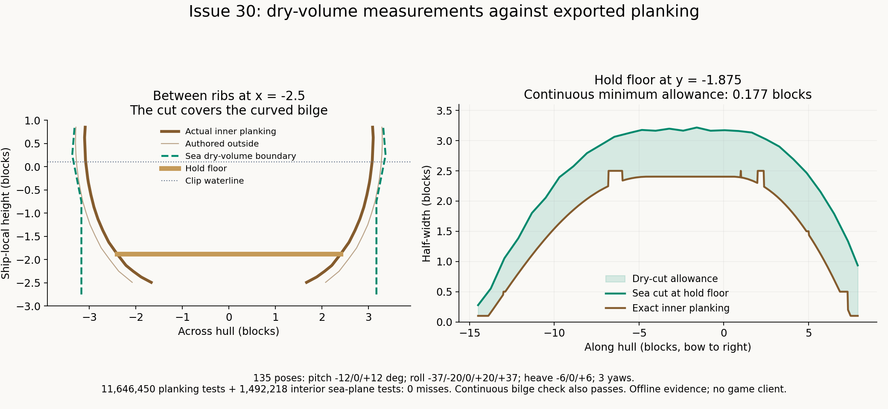
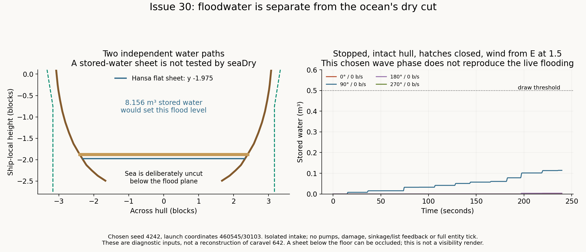

# Issue 30: caravel hold water, 31 October 2026

The reported sheet was **not reproduced as a dry-volume leak**. The caravel's cut covers the actual inner planking, including the bilge between ribs and all longitudinal positions along the hold floor. Enlarging `waterClip`, increasing its height, or adding profile levels is not supported by these measurements. No hull data or Sea files were changed. This report does **not** claim a visually verified fix for the screenshot.

The strongest available explanation is Hansa's stored floodwater and its intentional exception to Sea's cut. There is now live-session corroboration: the existing chat log records caravel **642** launched at **14:08:45**, then foundering warnings at **14:12:46** and **14:14:55**. The screenshot file is timestamped **14:14:36**. Hansa sends that warning when a ship enters its flooding/foundering state; it is not a shader warning. Read-only excerpts are in [live-evidence.txt](live-evidence.txt).

Those warnings do not contain a ship ID or water quantity themselves. The same session records `hansa-0.1.0-dev.16.zip`, while the screenshot filename says dev.15; the file timestamp is not frame telemetry. Thus this is strong supporting evidence for the matching caravel session, not an exact measurement of the pictured frame's water or a proof that every visible pixel is Hansa's mesh. The old screenshot of entity 1938 has even less runtime state. Neither image alone identifies the rendering path.

**Geometry and clip evidence**



The new harness loads the actual Hansa assembly, calls `ShipDefinition.Init` and `ShipWater.Clip`, and reads the exported mesh. It selects inner planking from **both** `interior` and `slot:hull:interior`, excluding rib timber. Its across-hull ray/triangle intersections are independent of the collision voxels and authored `DryOutline`.

| Measurement | Result |
| --- | --- |
| Detailed outline | 4 × 32; lowest row at local y −0.75, step 1 |
| Clip pivot, level | local y +0.1; rotated with the hull, as already fixed |
| Dry band | −3.25..+2.125 relative to the pivot; local −3.15..+2.225 |
| Hold floor | local y −1.875, safely inside the band |
| Fine sections | 6,028 usable sections, 0 narrower cuts; x spacing 0.025 |
| Continuous bilge check | 24,884 polygon vertices/station crossings, 0 misses |
| Continuous floor check | 6,685 vertices/crossings, 0 misses |
| Minimum continuous width allowance | 0.17716 blocks, at the narrow aft post tip (x −14.5, |z| 0.1) |
| Floor allowance away from those tiny tips | at least 0.39599 in the regular sections with inner half-width >0.1 |
| Transformed planking | 11,646,450 tests, 0 misses |
| Interior points on horizontal sea planes | 1,492,218 tests, 0 misses |
| Float shader port vs Sea's CPU test | 0 disagreements at all transformed planking samples |

The continuous check matters: below the first row Sea holds its bottom widths. Within each longitudinal station interval the cut width is linear in x, and each exported planking triangle is planar. After clipping triangles to the bilge and testing their vertices and station crossings, the minimum width difference is attained at a tested point. This covers positions between the regular x samples, rather than assuming a sampling interval happens to catch every pocket.

The transformed sweep uses 86,270 actual planking samples, at most 0.15 blocks apart, displaced 0.005 into the air. Its dry-hull bounds are x −14.5..8, y −2.7..0.525, including all the below-floor inner side planking. It tests **135 poses**: yaw 0/0.37/π÷2; pitch −12/0/+12°; roll −37/−20/0/+20/+37°; heave −6/0/+6. World coordinates use caravel 642's logged launch position, 460545/30103. Camera-relative float arithmetic follows `WaterRenderer.Prepare`. Sea planes sweep −6..+6 relative to mean sea in 0.25-block steps; qualifying interior points span −5.598..+4.172 relative to the clip pivot in world height.

`SeaDry.cs` ports the actual `seaDry` and `seaDryHalfWidth` calculations. It verifies normalized source fingerprints **and the compiled Sea DLL's GLSL constants** before running. Both dry/flood states and an intentionally halved-width outline are tested as negative controls. The original shader and loaded binaries have recorded hashes in [evidence.json](evidence.json).

The Sea job was actively changing its checkout. Its inputs were copied read-only into this worktree's `obj/issue30-inputs/Sea` for the final run. That snapshot identifies itself as pre.11; the dry-cut formulas are also the same as the main `Sea/src` versions. The sweep tests displaced positions themselves, so its volume coverage does not depend on the wave spectrum choosing particular crests. It is not an offline GPU render or an exact replay of the pre.10 live wave field.

**The four candidates**

1. **Narrow profile or inset:** not reproduced. `caravel_layout.py` samples the outer hull field, not rib inner faces. `WaterClipDef.Build` fits its four rows outward. Detailed widths do not have `DryInset` subtracted; that margin is removed from the footprint's length. At cargo-floor height the held bottom row is substantially wider than the actual bilge.
2. **Dry height/depth vs large waves:** not reproduced. The band is tested in the inverse hull frame. Heave translates the hull and cut together. A water fragment lying in the hold stays inside that band's local heights even if it is several blocks from the mean sea or the pivot's world height.
3. **Calm/heel waterline vs drawn hull:** not reproduced. The existing pivot correction is present. The clip uses the same `RenderOrigin`, yaw, pitch and roll as the ship. Sea skips vertex calming for `Dry` clips; `CalmSlopeAcross` does not determine the dry hull frame.
4. **Neighbouring chunk/far water:** no chunk-dependent bypass appears in the tested path. Both `chunkliquid` and `chunkliquiddepth` discard fragments using the displaced `seaFragPos` and the same uniforms. Wmap's far-terrain source starts at least 48 blocks away and discards its near fragments, so it does not explain geometry lying in this hold. Runtime shader fallback or an upload failure cannot be excluded from source and a screenshot; no GPU state was captured.

**Hansa's separate water path**



`EntityShip.Flooded` is `Water > 0.5` m³ (`ShipFlooding.cs:95`). `ShipRenderer.DrawFlood` (`ShipRenderer.cs:794`) then generates a separate, translucent saltwater mesh using `ShipWater.Surface`. It is level in the world, with slight slosh/bobbing and an interior tint. It uses the standard ship rendering path; Sea's `seaDry` does not process it.

`ShipWater.Clip` deliberately sends `Flooded=true` and `FloodY` when that water exists. Sea then **leaves ocean fragments below that flood plane visible inside the hull**. This is tested: the same interior point is cut with no flood plane and left visible when under an explicitly registered one. A bigger dry outline would not remove Hansa's own mesh or override that intentional flood exception.

For scale, the actual caravel hydrostatics put **8.15625 m³** at local level **−1.975**, 0.1 below the hold floor. The harness generates that sheet. A below-floor sheet may be occluded by floor or planking: the diagram is a section, not a rendered reproduction of its visible pockets.

An intact ship can take water over deck edges/scuppers with closed hatches: `ShipFlood.Downflooding` (`ShipDamage.cs:1625`) applies the authored `DeckShare=0.05`, then `ShipFlooding.cs:689` integrates it into stored water. An intact hull therefore does not imply an empty bilge in these seas. Disabling that intake would change gameplay policy, not repair a demonstrated clip error.

The isolated intake diagnostic uses the current frozen Sea spectrum, Hs **5.5** at strength **1.5**, wind from E, key 4242, launch position 460545/30103, 240 seconds, 0.25-second steps, four cardinal courses and speeds 0/13.3 b/s. It has all openings closed and no pumps, damage, sinkage/list feedback or full entity tick. All eight breeze controls admit zero. Stopped storm cases admit **0..0.1141 m³**, none reaching the drawing threshold in that interval. Underway cases admit **0.0016..88.9022 m³**. The stopped simulation therefore does **not** reproduce the live foundering warnings: the actual seed, heading, openings, prior water and full entity state are unknown. These numbers demonstrate sensitivity to those inputs, not a reconstruction of caravel 642.

**Changes left for review**

- `tests/Issue30Tests`: source-checked float port, independent planking geometry queries, continuous bilge/floor coverage, pose/sea-plane sweeps, flood controls, intake diagnostic and reproducible figures.
- Client command **`.hansa watercheck`**: read-only stored water/rate, Flooded/GoneDown, drawn flood-mesh state, pose, exact computed clip, Sea's injection/fallback flags and water-program uniform capabilities. It selects the ship aboard, otherwise the looked-at or nearest one. Clip construction was extracted into `ClipFor` so the report and normal registration use the same calculation.
- No waterClip or mesh regeneration: both assets remain byte-identical. No flooding policy was changed. No Sea patch is proposed without a reproduced Sea defect. No commits were made.

If another capture is made, `.hansa watercheck` while the sheet is visible will distinguish stored water from a disabled dry shader or a correctly registered empty-hull case. It reports computed values and shader capabilities; it does not pretend to read actual GPU uniform values. The existing pump water readout and `/hansa info` also expose stored water without changing it. The command was compiled; its client UI was not exercised because no game client was launched.

**Verification**

- Hansa build with `-p:SeaRoot="C:\VS mods\Sea"`: passed; four existing obsolete `ShapeElement.Faces` warnings. Outputs are in `bin/issue30-build` to avoid the sandbox's blocked default compiler output.
- `Issue30Tests`: **ALL OK**; measurements above. Raw logs, CSVs and input hashes are in `obj/issue30`; the concise evidence is checked in beside this report.
- Existing `HansaTests` `dry`: **ALL OK** for caravel, hansa-carrack and carrack.
- Existing `HansaTests` `design caravel`: **ALL OK**.
- `ConstructionTests`: **99/99** passed.
- Dedicated server: completed with **11 FAILED** in unchanged legacy carrack-m modular-layout/sealing/stair expectations and hull-slot save/reload. [Exact failures](selftest-failures.txt). Its caravel dry-space, wave response, flood-plane and sinking checks passed. This is not a fully green server suite and does not test client pixels. No historical designs were repaired for this task.
- Server PID 11556 shut down normally at **14:40:33**. Process gone; both UDP and TCP **42597** free. Isolated data/logs are in `testserver/issue30-dry-cut-20261031`. Setup initially had an unsupported CLI argument and then omitted the vanilla mod path; these were corrected before the completed run.
- Figures regenerated and visually inspected. `git diff --check` passed.

To reproduce the offline check and figures, without starting a client or server:

```powershell
powershell -ExecutionPolicy Bypass -File tests/Issue30Tests/run.ps1 `
  -SeaRoot "C:\VS mods\Sea" `
  -SeaSourceRoot "C:\VS mods\Sea\.claude\worktrees\codex-storm-waves"
```

This builds Hansa against the existing main Sea build, freezes the chosen Sea source/DLL inputs in Hansa's `obj`, builds/runs the small harness against that DLL, and regenerates the pictures. It never builds Sea or installs a mod. The script supports explicit game/Python paths. Saved user worlds, Mods and game files were not modified; the existing logs were read only.
